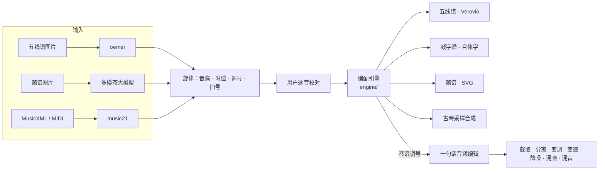

# 系统架构

三层：小程序前端负责输入与展示；微信云托管上的 API 服务负责用户、任务、支付与存储；计算服务负责识谱、编配、渲染、合成和音频编辑。耗时任务异步执行，前端轮询进度。

编配引擎定下的琴谱调号也交给音频编辑，用来把原曲伴奏移到同一个调。

## 编配引擎（`engine/`）

| 文件 | 作用 |
| --- | --- |
| `temperament.py` | 十三徽弦长比例；按音、泛音音高比；距徽 20 音分以内吸附到徽，否则记为徽分 |
| `tuning.py` | 定弦（当前：正调 C D F G A c d，一弦 = MIDI 36） |
| `arranger.py` | 候选生成、代价函数、Viterbi、左右手指法、减字部件与白话说明、自动选调 |

代价 = 弹法代价（散 0 / 按 1 + 高徽位附加 / 泛 1.5）+ 转移代价（换弦距离、左手移动徽数、弹法切换）− 走手音奖励。
水平决定候选范围（入门：只有散音和七徽以下按音），风格只改权重（古韵：泛音更便宜、同弦按音相连改为走手音）。

右手指法目前是启发式：六、七弦用抹，同弦接在抹之后用挑，其余用勾；左手七徽以下用名指，以上用大指。待按创始人翻弹谱校准。

## API（`server/`）

- `GET /healthz`
- `POST /api/arrange`：`{notes: [{pitch, duration}], tuning, level, style, auto_key}` → `{transpose, placements: [{string, technique, position, left_finger, right_finger, slide, jianzi, explain}]}`；无法弹奏的音返回 422 和音符下标。
