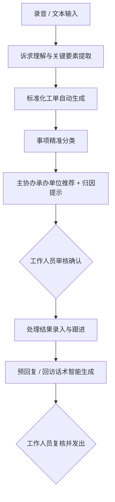

# 12345热线工单智能生成与转派辅助智能体 - 赛题全景说明与参赛规划指南

> **大赛官方链接**：[极市开发者平台赛题详情](https://cvmart.net/race/11419/des)  
> **所属赛事**：2026长三角（芜湖）算力算法创新应用大赛  
> **赛道分类**：数据赛道  
> **赛题名称**：12345热线工单智能生成与转派辅助智能体  

---

## 一、 赛题背景与核心目标

### 1. 业务痛点背景
12345政务服务便民热线作为党委政府倾听民意、纾解民困的“总客服”，每天产生海量群众诉求。传统人工处理流程中面临四大痛点：
1. **工单整理效率低**：接线员边听边记，对话冗长、口语化表达碎片化，人工提取要素耗时长，录单易漏错；
2. **事项分类依赖经验**：政务事项权责清单繁杂交叉，人工根据经验判定分类容易产生主观偏差；
3. **部门匹配转派耗时**：职能部门条块分割、权责界限模糊，“推诿扯皮”、“二次退单”现象普遍；
4. **回复质效难以统一**：答复话术参差不齐，政策依据引用不精准，回访满意度监控滞后。

### 2. 赛题目标
利用大语言模型（LLM）和 AI Agent 智能体技术，构建**面向12345热线工作人员的工单处理全流程辅助智能体**，全面提高诉求理解、工单生成、精准分类、智能转派和回复辅助的效率与规范性。

> ⚠️ **红线原则（人机协同）**：  
> 智能体**只提供辅助建议**，严禁未经审核自动派单或自动向群众答复！最终工单内容、转派结果和群众回复**必须由工作人员审核确认**。

---

## 二、 赛程安排与重要时间节点

| 阶段 | 时间安排 | 核心任务与里程碑 |
| :--- | :--- | :--- |
| **开赛与报名** | 8月1日 10:00 | 大赛正式启动，线上报名通道开启 |
| **初赛截止** | 9月14日 12:00 | 初赛作品提交截止，报名通道关闭 |
| **初赛评审** | 9月14日 - 9月17日 | 组委会专家方案审核，公布入围复赛团队名单 |
| **复赛阶段** | 9月17日 - 10月中旬 | 晋级团队进入**极智平台**，完成智能体部署与验证 |
| **复赛审核** | 10月中旬 | 复赛成果专家评审，公布晋级全国决赛名单 |
| **决赛与颁奖** | 11月初 | 现场答辩路演、产品Demo演示与颁奖典礼（芜湖） |

---

## 三、 核心业务流程与辅助处理闭环

### 1. 12345热线标准业务流程

### 2. 智能体端到端辅助闭环
智能体需紧密围绕上述业务主线，构建**人机协同（Human-in-the-loop）**闭环：

> 📌 **架构设计要求**：
> 1. 作品无需接入真实12345热线生产内网系统，支持通过**模拟业务环境**展示端到端闭环。
> 2. **数据流打通**：各功能模块之间必须能够顺畅传递与消费工单上下文，**严禁做成孤立的单点问答模块**。

---

## 四、 赛题任务拆解（必选任务 vs 创新拓展）

### （一）四大必选核心任务

#### 1. 诉求理解与要素提取分析
* **多模态输入支持**：
  * **录音输入**：支持上传脱敏后的电话录音音频，智能体自动 ASR 语音转文字；
  * **文本输入**：支持直接输入群众反映的口语化文字。
* **六大关键要素精准提取**：
  * **时间**（事发时间/反映时间）
  * **地点**（详细事发地址、所属区县、道路、标志性建筑）
  * **涉及人员/对象**（诉求人、被举报对象、涉事施工方、物业方等）
  * **主要事件**（矛盾起因、经过、当前现状）
  * **群众核心诉求**（修缮、处罚、退款、停工、政策解答等）
  * **其他工单相关要素**（紧急程度、重复来电标识等）
* **鲁棒性机制**：针对要素缺失、方言歧义、情绪激动表达模糊的场景，智能体应能**主动提示工作人员补充确认或人工核实**。

#### 2. 智能工单生成
* **规范字段生成**：
  * **工单标题**：规范格式（如：`【地点】关于【核心问题】的【诉求类型】`）
  * **问题摘要**：简练精炼的百字内情况概述
  * **诉求详情内容**：忠实还原原始事实，进行条理化口语转书面语润色
  * **结构化关键要素**与**推荐事项类别**
* **原则准绳**：必须**忠实反映群众诉求事实**，严禁幻觉脑补、改变原意或捏造事实。

#### 3. 事项分类及承办单位推荐
* **推荐输出矩阵**：
  * **事项类别**（结合政务分类目录层级体系）
  * **主要承办单位**（牵头核心主责部门）
  * **候选协办单位**（联合执法或协同处办部门）
  * **推荐理由 / 权责清单依据 / 人工复核提示**
* **交叉研判兜底**：遇到多头治理、职责交叉、信息不充分或边缘盲区事项时，必须给出置信度提示并引导人工裁定。
* **案例验证要求**：参赛成果必须提供**至少 2 个不同类型的典型群众诉求案例**进行现场/录制验证。

#### 4. 回复辅助生成
* **多场景话术生成**：
  * **受理即时提示**：受理阶段告知诉求人办理时限与流程的话术；
  * **办理协同建议**：供承办人员核处参考的法律法规和政策指引；
  * **标准预回复内容**：向群众答复的标准化、有温度的书面答复；
  * **回访参考话术**：回访员电话复核群众满意度时的交互话术；
  * **回复质检与润色建议**：对人工草拟答复的内容进行合规、语气、完整性审查。
* **安全红线**：所有生成文本仅供内部参考，严禁未经工作人员确认由系统对外自动推发。

---

### （二）创新拓展方向（官方可选加分项）
1. **多轮追问智能引导**：当输入信息缺失关键时空要素时，智能体自动生成建议追问清单，辅助接线员当场补全；
2. **工单质检与合规审计**：对生成工单与答复文本开展自动化质检（事实一致性、语气规范度、保密脱敏审查）；
3. **相似历史工单检索推荐**：基于向量数据库/RAG 检索历史相似疑难案件的处办经验、判定依据与答复范式；
4. **热点舆情与态势感知**：对多源诉求进行语义聚合，提炼城市民生热点、突发群诉苗头与宏观统计洞察。

---

## 五、 主要面向使用对象（用户画像）

1. **12345热线受理人员 / 接线员**：辅助听录、即时摘要、要素提取与补全提示；
2. **工单审核人员**：工单规范性校验、重复件识别、事实一致性核对；
3. **工单转派人员**：三级分类辅助、权责清单匹配、主协办智能推荐；
4. **部门职责协调人员**：争议工单定责仲裁、权责交叉调处依据支撑；
5. **工单回复审核人员**：部门反馈内容质检、预回复修改与合规润色；
6. **热线质检监督与管理决策人员**：回访质效分析、民生诉求大盘监控与辅助决策。

---

## 六、 官方数据与资源支持

### 1. 官方提供的基础数据
* **事项分类目录**：12345热线事项分类目录（标准12个大类及细分类别）。
* **示例数据集下载**：
  * **文件名**：`12345赛题数据集-信件类别示例工单及录音.zip`
  * **百度网盘链接**：[点击前往百度网盘下载](https://pan.baidu.com/s/1ysOOYqmoAQTr_yJWQLXoyw)
  * **提取码**：`u9ca`

### 2. 知识库自建与引用规则（重要加分项）
* 主办方不强制提供官方全量知识库，鼓励参赛队伍**自建政策库**；
* 参赛团队可自主收集**芜湖市公开发布的市政、交通、住房、物业、拆迁、民政等政策文件和政务办事指南**；
* 在智能体中注明公开来源、法律文号及适用范围；能够**精准引用政策法规作为分类派发和回复依据的，将作为系统合规性与落地价值的核心加分项**。

---

## 七、 赛事作品提交要求与阶段规范

### （一）初赛阶段：参赛作品创意说明书
* **考察重点**：业务理解、创新性、技术可行性、应用价值和合规意识（不强制交付可运行系统）。
* **初赛提交材料**：
  1. **参赛作品创意说明书**（PDF/Word）；
  2. **智能体技术架构图**（高清矢量图或图片）；
  3. **产品原型图、界面示意图、介绍视频或体验链接**（选填加分项）。
* **提交渠道**：
  * 渠道1：[官方腾讯文档表单提交](https://doc.weixin.qq.com/forms/AH8AbAfiAAgAQ0ACwY5AGoCNqeQGnjISf)
  * 渠道2：极市平台官网赛题页【作品提交】，上传 ZIP 压缩包（≤200MB，大文件可用网盘链接 txt 归档）；
  * **文件命名规范**：`赛题—团队名称`。

### （二）复赛阶段：极智平台智能体开发
* **考察重点**：创意方案工程化落地能力、真实场景运行稳定性与交互体验。
* **开发环境**：晋级团队在规定时间内进入**极智平台**，调用平台算力、LLM、知识库与工作流插件进行开发。
* **复赛提交材料**：
  1. **极智平台可运行智能体 Demo**（发布并提供访问体验地址）；
  2. **复赛作品解决方案 PPT / PDF**（包括产品设计、技术实现、测试样本输入及结果对比、提示词工程与工具调用说明等）；
  3. **3-5 分钟真实运行演示视频**（录屏演示核心业务闭环）；
  4. 其他补充材料（可选）。
* **文件命名规范**：`赛题名称-团队名称-作品名称.zip`。

### （三）决赛阶段：现场答辩与演示
* **考察重点**：成果完成度、业务价值、落地可行性、商业化前景与团队综合实力。
* **决赛提交材料**：
  1. 现场汇报答辩 PPT；
  2. 现场可操作的真实演示系统（务必准备离线版或本地兜底录屏）；
* **形式**：线下路演陈述 + 产品现场交互演示 + 评委专家问答。

---

## 四、 评审规则与评分权重表

### 1. 初赛评审标准（满分 100%）
| 评审维度 | 考察核心内容 | 权重 |
| :--- | :--- | :---: |
| **赛题理解与业务流程契合度** | 是否深刻理解12345热线受理、工单生成、转派、回复与回访的政务闭环，链路是否完整 | **25%** |
| **方案创新性** | 智能体交互设计、多 Agent 协作架构、Prompt工程或人机协同机制是否有新颖突破 | **25%** |
| **技术可行性** | 录音识别、长文本要素抽取、权责知识检索与单位推荐的技术选型是否成熟可靠 | **20%** |
| **应用及产业价值** | 能否切实为基层接线员降本增效，方案是否具备标准化推广与落地潜力 | **20%** |
| **合规性** | 是否严格考虑数据隐私脱敏、人机协同审核卡点、政策依据引用溯源 | **10%** |

### 2. 复赛评审标准（满分 100%）
| 评审维度 | 考察核心内容 | 权重 |
| :--- | :--- | :---: |
| **应用性** | 能否切实解决实际政务工单处理卡点，生成内容是否符合政务公文与处理规范 | **35%** |
| **智能性** | 复杂诉求语义理解准确率、要素提取完整性、分类与承办单位推荐的合理度与归因能力 | **25%** |
| **技术性** | 系统整体架构合理度、极智平台组件调用成熟度、复杂工作流或工具链亮点 | **15%** |
| **完整性与使用体验** | 端到端流程是否连贯顺畅，界面交互是否专业优雅易用，运行是否稳定抗造 | **15%** |
| **合规性** | 敏感信息脱敏过滤、工作人员二次复核确认机制、争议风险提示能力 | **10%** |

### 3. 决赛评审标准（满分 100%）
| 评审维度 | 考察核心内容 | 权重 |
| :--- | :--- | :---: |
| **项目成果与完成度** | 核心业务功能是否全部实现，工程交付物是否完备规范 | **25%** |
| **业务应用效果** | 在真实/模拟工单样本上的生成精度、转派准度及回复质效提升数据佐证 | **25%** |
| **创新性与技术性** | 相比竞品的差异化优势、算法策略创新、多模态智能体协同技术壁垒 | **15%** |
| **推广及产业价值** | 跨区县、跨行业场景复用性，政务数字化改革落地价值 | **15%** |
| **在芜落地计划** | 针对芜湖本地产业链生态的商业化发展规划、落地公司运营设想 | **10%** |
| **现场陈述与团队能力** | 演讲表达清晰度、Demo 演示流畅度、答辩应对水平与团队落地交付实力 | **10%** |

---

## 九、 参赛规则与队伍要求

1. **参赛对象**：面向全社会开放，高校学生、科研院所、科技企业、独立开发者团队均可报名；
2. **团队构成**：每支参赛队伍由 **1-10 名成员** 组成，需指定 1 名队长作为责任人；
3. **实名认证**：所有成员必须在极市平台完成实名认证；
4. **唯一性原则**：每位选手在同一赛题中只能加入一支队伍，严禁一人多号违规挂靠；
5. **组织职责**：队长负责统一对接组委会、任务分工、作品上传及奖金分配等事宜。

---

## 十、 奖项设置与芜湖市专属落地扶持政策

### 1. 赛事奖金设置（数据赛道）
* 🥇 **冠军（1支）**：**¥ 50,000 元人民币**（税前）
* 🥈 **亚军（1支）**：**¥ 30,000 元人民币**（税前）
* 🥉 **季军（1支）**：**¥ 20,000 元人民币**（税前）

> 💡 **奖金兑现与落地要求**：  
> 获奖冠、亚、季军团队需在 **2026年12月底前** 在芜湖市注册成立独立法人企业或设立子公司（芜湖本地已有注册企业无需重复注册）。组委会将开辟绿色通道协助团队一站式注册落地；奖金将在开户后发放至企业公户。

### 2. 芜湖市地方高额产业与人才扶持政策
针对大赛优秀获奖团队，芜湖市给予极具竞争力的“真金白银”专项赋能政策：
1. **场景落地试点补助**：对在芜湖落地实施的优秀 AI 创新应用试点项目，按项目实际投入的 **30% 给予最高 50 万元补助**；
2. **标杆示范项目重奖**：获评芜湖市级人工智能及算力“标杆示范项目”的，**一次性奖励 100 万元**；
3. **研发与智造激励**：入选研发投入优秀企业的给予 **50 万元一次性奖励**；数字化车间/智能工厂最高补助 **300 万元**；
4. **“算力券 / 数据券”补贴**：
   - 算力资源使用按服务费的 **20%-25% 给予补贴**；
   - 入驻创新孵化载体的小微初创团队，算力券兑付比例高达 **70%（最高 10 万元/年）**；
   - 建设高质量数据集给予最高 **30 万元补助**，打造可信数据空间给予最高 **50 万元补助**；
   - 开展垂直大模型与 Agent 场景研发的，按技术服务费 **40% 给予最高 200 万元补助**；
5. **青年人才创业金融支撑**：
   - 在校及毕业 5 年内高校青年人才在芜设立团队的，可申报最高 **100 万元无偿资助**；
   - 配合提供最高 **500 万元股权投资** 支持与最高 **1000 万元债券融资** 支持；
   - 享受芜湖市“紫云英人才计划”住房安居补贴、生活补贴及子女优享医疗教育资源。

---

## 十一、 团队产品定位、差异化壁垒与实战规划指南

### 1. 差异化破局思考（如何击败竞品，打动政企评委）
*参考资料：[竞争格局分析-12345赛道.md](file:///d:/竞赛/12345热线工单智能生成与精准转派全流程辅助Agent/竞争格局分析-12345赛道.md)*

传统12345厂商多停留在“单次表单填写辅助”与“简单文本大模型润色”，存在明显局限。我们要打造**全流程具身闭环智能体**：
1. **呼叫中心级的多模态交互体验**：
   - 融合端到端语音大模型交互（类似 Call-E / 语音 Agent 技术架构），支持电话录音真实降噪质检、多方通话要素捕捉；
   - **拟人化主动回访 Agent**：除了工单派发，打造能自主拨打电话、短信、微信服务号回访收集回执闭环的智能体。
2. **政务严谨性（可解释性与溯源验真）**：
   - **引用溯源（Citation Grounding）**：不仅给出主协办部门和分类，而且把芜湖市本地政务机构职能编制方案（三定方案）、最新市政法规的条款切片作为证据链原原本本溯源展现；
   - **长文本事实冲突检测**：自动核验诉求人历史工单、当前反映事实、涉事部门过往答复之间的矛盾冲突点，主动拦截重复非理性投诉。
3. **决策支持与民生治理沙盘**：
   - 跳出接线员视角，为“热线指挥中心”提供热点事件态势推演、重复派单预警与部门推诿仲裁分析。

### 2. 工程化与多端发布方案（从本地开发到极智/Coze平台）
*参考案例：[coze编程平台使用案例](file:///d:/竞赛/12345热线工单智能生成与精准转派全流程辅助Agent/coze编程平台使用案例)*

1. **本地先行、极致打磨**：
   - 遵循规范，在本地先构建好完整技术架构、Prompt 拓扑、知识库构建脚本以及高颜值的原型界面（单文件 HTML 工作台 / Next.js）；
   - 确保核心逻辑组件解耦（ASR模块、要素提取模块、派单推荐模块、公文回复润色模块），支持封装成清晰的 Skills / Tools。
2. **极智平台与 Coze 平台无缝复现与发布**：
   - 借助 Coze 编程平台（以及复赛指定的极智平台），将本地验证完毕的 Prompt、向量知识库与工作流节点进行组件化拼装；
   - 发布高可用 Web 端体验链接，用于复赛提交与决赛路演无障碍实时展示；
   - 生成完整 3-5 分钟录屏搭配演练逐字稿，确保无论网络环境如何均能 100% 稳妥展现。
